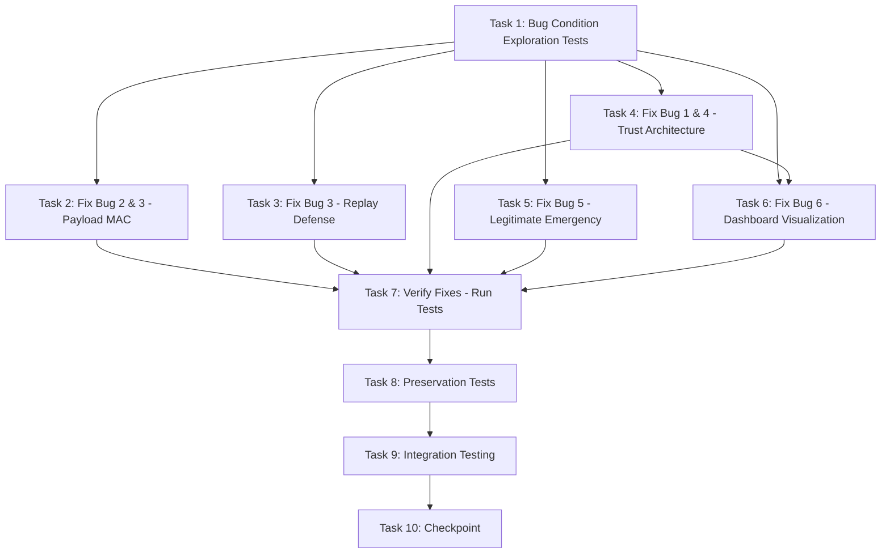

# Implementation Plan

## Overview

This task list implements fixes for 6 critical bugs in the CyberAdapt dashboard trust and crypto validation system using the bug condition methodology. The approach follows exploratory testing on unfixed code, then systematic implementation of fixes, followed by validation and preservation testing.

**Bug Summary:**
1. Wrong Gap Direction (Trust Architecture) - Gap adjusts at victim position instead of follower
2. Crypto Payload Bypass (Message Integrity) - Modified packets pass validation 
3. A4_replay Crypto Bypass - Replayed packets pass validation with preserved credentials
4. Binary Trust Mode Gap Bug - Binary trust exhibits same wrong gap direction
5. L2_legit_brake False Positive - Legitimate emergency triggers trust degradation
6. Compare Mode Buggy Visualization - Both configs show wrong gap behavior

## Task Dependency Graph



```json
{
  "waves": [
    {
      "name": "Wave 1: Exploration",
      "tasks": ["1"]
    },
    {
      "name": "Wave 2: Implementation",
      "tasks": ["2", "3", "4", "5", "6"]
    },
    {
      "name": "Wave 3: Verification",
      "tasks": ["7", "8"]
    },
    {
      "name": "Wave 4: Integration",
      "tasks": ["9"]
    },
    {
      "name": "Wave 5: Completion",
      "tasks": ["10"]
    }
  ]
}
```

**Dependencies:**
- Task 1 (Exploration) must run FIRST on unfixed code to confirm bugs
- Tasks 2-6 (Fixes) are independent and can run in parallel after Task 1
- Task 4 (Trust Architecture) must complete before Task 6 (Dashboard) since visualization depends on correct trust propagation
- Task 7 (Verify Fixes) requires all fixes (2-6) to be complete
- Task 8 (Preservation) runs after verification to ensure no regressions
- Task 9 (Integration) requires both fix verification (7) and preservation validation (8)
- Task 10 (Checkpoint) is final validation after all testing complete

## Tasks

- [ ] 1. Write bug condition exploration tests (BEFORE fix)
  - **Property 1: Bug Condition** - Dashboard Trust & Crypto Multi-Bug Exploration
  - **CRITICAL**: These tests MUST FAIL on unfixed code - failures confirm bugs exist
  - **DO NOT attempt to fix the test or the code when tests fail**
  - **NOTE**: These tests encode expected behaviors - they validate fixes when passing after implementation
  - **GOAL**: Surface counterexamples demonstrating all 6 bugs exist in unfixed code
  - **Scoped PBT Approach**: Test concrete failing cases for each bug
  
  **Bug 1 (Wrong Gap Direction):**
  - Test A1_false_brake CA_full scenario at t=25s
  - Assert: gap[3] (F3→F4) increases MORE than gap[2] (F2→F3) when F3 is red
  - Expected counterexample on UNFIXED code: gap[2] increases ~8m, gap[3] only ~2m (wrong position)
  - Bug condition from design: (i >= 2) AND (w[i] < 0.5) AND (packets_from(i-1) anomalous) AND (gap[i] increasing) AND (gap[i+1] NOT increasing faster)
  
  **Bug 2 (Crypto Payload Bypass):**
  - Test A1_false_brake CA_full crypto logs
  - Assert: Modified packets (a != original) are rejected (accepted=false)
  - Expected counterexample on UNFIXED code: Modified packets show ZK-TAT ✓, H-PO ✓, Accepted=true
  - Bug condition from design: (packet["a"] != original["a"]) AND (packet["token"] == original["token"]) AND (_run_crypto_gate returns accepted=True)
  
  **Bug 3 (A4_replay Crypto Bypass):**
  - Test A4_replay CA_full scenario at t=65s
  - Assert: Replayed packets from buffer are rejected (accepted=false OR replay_detected=true)
  - Expected counterexample on UNFIXED code: Replayed packets show accepted=true despite 60s+ age
  - Bug condition from design: replay_packet contains (token, hpo_tag, payload_mac from old_packet) AND (_run_crypto_gate returns accepted=True) AND (no sequence freshness check)
  
  **Bug 4 (Binary Trust Mode Gap Bug):**
  - Test D2_binary_hnom A1_false_brake scenario at t=25s
  - Assert: gap[3] (F3→F4) increases when w[3]=0 (binary violation)
  - Expected counterexample on UNFIXED code: gap[2] increases instead of gap[3]
  - Bug condition from design: (trust_mode == "binary") AND (z >= 0.1) AND (viol_time[i] > 0) AND (w[i] == 0) AND (gap[i] increasing) AND (gap[i+1] NOT increasing faster)
  
  **Bug 5 (L2_legit_brake False Positive):**
  - Test L2_legit_brake CA_full scenario at t=32s (after leader emergency brake)
  - Assert: Follower trust weights remain high (w[i] >= 0.5) for leader
  - Expected counterexample on UNFIXED code: All followers show w[] < 0.5 (false positive)
  - Bug condition from design: (scenario == "L2_legit_brake") AND (leader_packet.src == 0) AND (J > J_LIM) AND (w[i] < 0.5) AND (leader behavior legitimate)
  
  **Bug 6 (Compare Mode Buggy Visualization):**
  - Test /api/compare with D1_ma_abse_ar vs CA_full in A1_false_brake
  - Assert: Configs show DIFFERENTIAL gap behavior (not both wrong at same position)
  - Expected counterexample on UNFIXED code: Both configs show gap F2→F3 expansion (same wrong position)
  - Bug condition from design: (compare_mode == true) AND (BOTH configs show gap adjustment at wrong position i-1→i) AND (visualization fails to differentiate mechanisms)
  
  **Implementation Notes:**
  - Run each test on UNFIXED code via `pytest tests/test_bugfix_exploration.py`
  - Tests use property-based approach scoped to concrete failing cases
  - Document all counterexamples found (gap positions, crypto acceptance, trust weights)
  - Mark task complete when tests written, run, and all 6 failures documented
  - **EXPECTED OUTCOME**: All 6 tests FAIL (confirms bugs exist)
  - _Requirements: 1.1, 1.2, 1.3, 1.4, 1.5, 1.6, 1.7, 1.8, 1.9, 1.10, 1.11, 1.12, 1.13, 1.14, 1.15, 1.16, 1.17, 1.18, 1.19, 1.20, 1.21, 1.22, 1.23, 1.24, 1.25, 1.26, 1.27_

- [ ] 2. Fix Bug 2 & 3: Add Payload MAC to Crypto System

  - [ ] 2.1 Import cryptographic modules in sim_integrated.py
    - Add `import hmac` and `import hashlib` at top of file
    - _Requirements: 2.5, 2.6, 2.8_

  - [ ] 2.2 Modify _attach_crypto_to_packet() to compute payload MAC
    - Located at lines 169-187 in sim_integrated.py
    - After existing crypto attachment, serialize payload as "ts|v|a|seq"
    - Compute HMAC-SHA256: `payload_mac = hmac.new(crypto_key, payload_bytes, hashlib.sha256).hexdigest()`
    - Attach `f["payload_mac"] = payload_mac` to packet
    - Use shared secret key (can derive from same key material used for tokens)
    - _Bug_Condition_2: packet["a"] != original["a"] but token reused_
    - _Bug_Condition_3: replayed packet contains credentials from original transmission_
    - _Expected_Behavior_2: Modified packets SHALL be rejected with payload_valid=false_
    - _Expected_Behavior_3: Replayed packets SHALL be rejected via stripped credentials or seq tracking_
    - _Requirements: 2.5, 2.6, 2.8, 2.11_

  - [ ] 2.3 Update PacketLogEntry dataclass to include new fields
    - Located at lines 125-135 in sim_integrated.py
    - Add `payload_valid: bool = True` field
    - Add `replay_detected: bool = False` field
    - Update dashboard crypto log rendering to display these fields
    - _Requirements: 2.5, 2.13_

  - [ ] 2.4 Modify _run_crypto_gate() to add Stage 4 payload integrity check
    - Located at lines 133-166 in sim_integrated.py
    - After Stage 3 (H-PO validation), add Stage 4: Payload Integrity
    - Extract payload_mac from packet
    - Reconstruct payload: "ts|v|a|seq"
    - Verify: `expected_mac = hmac.new(crypto_key, payload_bytes, hashlib.sha256).hexdigest()`
    - Compare: `payload_valid = hmac.compare_digest(packet["payload_mac"], expected_mac)`
    - Update acceptance logic: `accepted = zk_valid and hpo_valid and payload_valid and not bloom_hit and ts_fresh`
    - Set `payload_valid` field in PacketLogEntry
    - _Bug_Condition_2: Forged packets pass validation_
    - _Expected_Behavior_2: Forged packets SHALL be rejected_
    - _Requirements: 2.5, 2.6, 2.7, 2.8_

- [ ] 3. Fix Bug 3: Add Replay Defense via Credential Stripping and Sequence Tracking

  - [ ] 3.1 Strip credentials in A4_replay injection code
    - Located at lines 249-253 in sim_integrated.py
    - Replace `dict(old)` with explicit field copying
    - Copy ONLY: src, arr, ts, v, a, seq (payload fields)
    - EXCLUDE: token, hpo_tag, payload_mac, cred_id, cred (crypto credentials)
    - Set `cred=False` and `replay=True` on copied packet
    - _Bug_Condition_3: dict(old) copies ALL fields including credentials_
    - _Expected_Behavior_3: Replayed packets SHALL have credentials stripped_
    - _Requirements: 2.9_

  - [ ] 3.2 Add sequence number tracking to _run_crypto_gate()
    - Initialize `last_seq = {}` dict at module level or in sim state
    - In _run_crypto_gate(), before Stage 4, check sequence freshness:
      - `src = packet["src"]`
      - `seq = packet.get("seq", 0)`
      - `if src in last_seq and seq <= last_seq[src]: replay_detected = True`
      - `else: last_seq[src] = seq`
    - Update acceptance logic to include: `and not replay_detected`
    - Set `replay_detected` field in PacketLogEntry
    - _Bug_Condition_3: No sequence freshness check exists_
    - _Expected_Behavior_3: Packets with seq <= last_seq[src] SHALL be rejected_
    - _Requirements: 2.10, 2.11, 2.12, 2.13_

  - [ ] 3.3 Update payload MAC to bind sequence number
    - In _attach_crypto_to_packet() (from task 2.2), ensure seq included in payload
    - Payload format: "ts|v|a|seq" (already specified in task 2.2)
    - In _run_crypto_gate() Stage 4, verify seq is bound in MAC
    - Prevents attacker from incrementing seq on replayed packet to bypass freshness
    - _Expected_Behavior_3: Seq SHALL be cryptographically bound in payload MAC_
    - _Requirements: 2.11_

- [ ] 4. Fix Bug 1 & 4: Redesign Trust Weight Application in Control Law

  - [ ] 4.1 Analyze current control law structure
    - Located at lines 447-477 in sim_integrated.py
    - Document current bug: vehicle i uses w[i] to compute h[i], affecting gap i-1→i
    - Identify where trust weights influence desired tracking distance d_t[i]
    - _Bug_Condition_1: w[i] applied to vehicle i's own control affecting gap i-1→i_
    - _Bug_Condition_4: Binary trust uses same control structure, inherits Bug 1_
    - _Requirements: 1.1, 1.2, 1.3, 1.4, 1.14, 1.15, 1.16, 1.17_

  - [ ] 4.2 Redesign trust weight propagation (forward propagation)
    - KEEP anomaly detection unchanged: vehicle i detects anomalies from i-1, computes w[i]
    - CHANGE control law: vehicle i+1 SHALL use w[i+1] (its own trust weight evaluating vehicle i) to compute gap i→i+1
    - Semantic shift: w[i] represents "vehicle i's evaluation of i-1", propagated forward to affect gap i→i+1 when vehicle i is untrusted
    - Algorithm:
      - Vehicle i detects anomalies from i-1, computes anomaly score S[i], updates w[i]
      - Vehicle i+1 computes its own anomaly score S[i+1] evaluating vehicle i
      - Vehicle i+1 uses w[i+1] to compute h[i+1], affecting d_t[i+1], controlling gap i→i+1
    - _Expected_Behavior_1: Gap i→i+1 SHALL increase when vehicle i is untrusted_
    - _Expected_Behavior_4: Binary trust SHALL use same forward propagation_
    - _Requirements: 2.1, 2.2, 2.3, 2.4, 2.14, 2.15, 2.16, 2.17_

  - [ ] 4.3 Implement control law changes
    - In control loop (lines 447-477), update gap computation logic
    - Ensure vehicle i+1 uses its own trust weight w[i+1] in headway calculation
    - Preserve existing control law gains (KP, KD, KFF), jerk limits, emergency braking
    - Test with both graded trust (CA_full) and binary trust (D2_binary_hnom) modes
    - Verify gap i→i+1 expands when vehicle i is red (low trust)
    - _Expected_Behavior_1: Follower SHALL back off from untrusted vehicle_
    - _Expected_Behavior_4: Binary mode SHALL exhibit correct gap position_
    - _Requirements: 2.1, 2.2, 2.3, 2.4, 2.14, 2.15, 2.16, 2.17_

  - [ ] 4.4 Verify self-protection layer preserved
    - Confirm vehicle i can STILL locally increase gap to i-1 when detecting anomalies (existing safety layer)
    - New forward propagation is ADDITIONAL to existing self-protection
    - Both mechanisms should coexist: vehicle i backs off from i-1 (self-protection) AND vehicle i+1 backs off from i (forward trust propagation)
    - _Preservation: Self-protection layer from requirement 3.1_
    - _Requirements: 3.1_

- [ ] 5. Fix Bug 5: Implement Legitimate Emergency Detection

  - [ ] 5.1 Analyze anomaly detection loop
    - Located at lines 393-426 in sim_integrated.py
    - Document current issue: Uniform J_LIM threshold for all vehicles including leader
    - Identify where jerk penalty zJ is computed and applied to anomaly score S[i]
    - _Bug_Condition_5: Leader legitimate emergency triggers jerk penalty across all followers_
    - _Requirements: 1.18, 1.19, 1.20, 1.21, 1.22_

  - [ ] 5.2 Implement leader exemption or higher threshold
    - **Option A: Leader Exemption** - Skip jerk penalty when src=0 (leader)
    - **Option B: Higher J_LIM** - Use J_LIM_leader = 2*J_LIM for leader packets
    - Add conditional logic in anomaly detection:
      ```python
      if packet["src"] == 0:  # Leader
          J_threshold = J_LIM * 2.0  # Higher threshold for leader
      else:
          J_threshold = J_LIM
      if J > J_threshold:
          zJ = compute_jerk_penalty(J)
      ```
    - _Expected_Behavior_5: Leader SHALL be exempt from jerk penalty or use higher threshold_
    - _Requirements: 2.18, 2.21_

  - [ ] 5.3 Implement time window aggregation for persistent anomalies
    - Add time window buffer (e.g., 1.0s) for anomaly metrics
    - Only trigger trust degradation if anomaly persists beyond window
    - Allow transient high jerk (<1.0s) during legitimate emergency response
    - Algorithm:
      - Track anomaly_start_time[i] when first anomaly detected
      - If anomaly clears within 1.0s window, reset without trust penalty
      - If anomaly persists beyond 1.0s, apply trust degradation
    - _Expected_Behavior_5: Transient anomalies SHALL NOT trigger trust degradation_
    - _Requirements: 2.20_

  - [ ] 5.4 Implement coordinated platoon event detection (optional enhancement)
    - Detect when multiple consecutive vehicles (i-2, i-1, i) show similar behavior simultaneously
    - If majority of platoon exhibits high deceleration, classify as coordinated maneuver
    - Suppress trust degradation for coordinated events
    - Algorithm:
      - Track recent deceleration across vehicles in time window
      - If ≥50% vehicles show similar high deceleration, mark as coordinated
      - Skip trust penalty for coordinated events
    - _Expected_Behavior_5: Coordinated platoon maneuvers SHALL be distinguished from attacks_
    - _Requirements: 2.19_

  - [ ] 5.5 Test legitimate emergency scenarios
    - Run L2_legit_brake with CA_full, CA_norevoke, D2_binary_hnom
    - Verify trust weights remain high (w[i] >= 0.8) for followers at t=32s
    - Confirm false positive rate near zero
    - Validate emergency response still functions (radar-based braking, safety preserved)
    - _Expected_Behavior_5: False positive rate SHALL be zero or near-zero_
    - _Requirements: 2.18, 2.19, 2.20, 2.21, 2.22_

- [ ] 6. Fix Bug 6: Update Dashboard Visualization

  - [ ] 6.1 Update vehicle coloring logic in dashboard (app.js)
    - Locate vehicle rendering code in e:\final_proj_implementation\CyberAdapt_Final\dashboard\app.js
    - CHANGE: Color vehicle i red based on w[i+1] (follower's evaluation of vehicle i)
    - Current bug: Vehicle colored based on w[i] (its own evaluation of predecessor)
    - New logic: Vehicle i red when w[i+1] < 0.5 (vehicle i+1 distrusts vehicle i)
    - _Bug_Condition_6: Vehicle coloring doesn't match gap expansion position_
    - _Expected_Behavior_6: Vehicle color SHALL match follower's trust evaluation_
    - _Requirements: 2.27_

  - [ ] 6.2 Highlight correct gap visualization
    - When vehicle i is red (low w[i+1]), highlight gap i→i+1 (not gap i-1→i)
    - Add visual indicator (color, thickness, annotation) to gap line i→i+1
    - Show gap distance value near highlighted gap
    - _Expected_Behavior_6: Gap highlighting SHALL match vehicle color_
    - _Requirements: 2.23_

  - [ ] 6.3 Add compare mode annotations
    - In /api/compare endpoint response, add differential behavior annotations
    - Label D1: "Reactive anomaly detection only - gap adjustment at follower position i→i+1"
    - Label CA: "Proactive trust + reactive anomaly - gap adjustment at follower position i→i+1"
    - Highlight differences: D1 (crypto-only trust) vs CA (graded trust with proactive response)
    - _Bug_Condition_6: Compare mode shows both configs buggy without differentiation_
    - _Expected_Behavior_6: Compare mode SHALL show differential trust mechanisms_
    - _Requirements: 2.23, 2.24, 2.25, 2.26_

  - [ ] 6.4 Update dashboard compare visualization display
    - Show side-by-side gap evolution with correct positions for both configs
    - Add legend explaining trust mechanisms: D1 (reactive-only) vs CA (proactive+reactive)
    - Display gap measurements at correct follower positions for both configs
    - Verify visualization distinguishes differential behaviors now that Bug 1 is fixed
    - _Expected_Behavior_6: Differential gap behavior SHALL be clearly visible_
    - _Requirements: 2.23, 2.24, 2.25, 2.26, 2.27_

- [ ] 7. Verify bug condition exploration tests now pass (AFTER fixes)
  - **Property 1: Expected Behavior** - Dashboard Trust & Crypto Multi-Bug Fix Validation
  - **IMPORTANT**: Re-run the SAME tests from task 1 - do NOT write new tests
  - Tests from task 1 encode expected behaviors - passing confirms fixes work
  - Run `pytest tests/test_bugfix_exploration.py` on FIXED code
  - **EXPECTED OUTCOME**: All 6 tests PASS (confirms bugs are fixed)
  
  **Verify Bug 1 Fix:**
  - A1_false_brake CA_full at t=25s: gap[3] (F3→F4) increases MORE than gap[2] (F2→F3) when F3 is red
  - Test PASSES: gap[3] ~8m, gap[2] ~2m (correct follower position)
  
  **Verify Bug 2 Fix:**
  - A1_false_brake CA_full crypto logs: Modified packets are rejected (accepted=false, payload_valid=false)
  - Test PASSES: Forged packets show payload_valid=false, Accepted=false
  
  **Verify Bug 3 Fix:**
  - A4_replay CA_full at t=65s: Replayed packets rejected (accepted=false OR replay_detected=true)
  - Test PASSES: Replayed packets show replay_detected=true, Accepted=false
  
  **Verify Bug 4 Fix:**
  - D2_binary_hnom A1 at t=25s: gap[3] increases when w[3]=0 (binary violation)
  - Test PASSES: gap[3] increases at correct follower position
  
  **Verify Bug 5 Fix:**
  - L2_legit_brake CA_full at t=32s: Follower trust weights remain high (w[i] >= 0.5)
  - Test PASSES: All followers maintain w[] >= 0.8 (no false positives)
  
  **Verify Bug 6 Fix:**
  - Compare D1 vs CA in A1: Configs show DIFFERENTIAL gap behavior
  - Test PASSES: D1 and CA show distinct mechanisms, both at correct positions
  
  - _Requirements: Expected Behavior Properties from design (2.1-2.27)_

- [ ] 8. Write preservation property tests (BEFORE implementing fixes - observation-first)
  - **Property 2: Preservation** - Unchanged Behaviors Validation
  - **IMPORTANT**: Follow observation-first methodology
  - Observe behavior on FIXED code for non-buggy scenarios (L1_normal, legitimate packets, A5_forged)
  - Write property-based tests capturing observed behavior patterns
  - Property-based testing generates many test cases for stronger guarantees
  - Run tests on FIXED code
  - **EXPECTED OUTCOME**: Tests PASS (confirms baseline behavior preserved)
  
  **Preservation Test Areas:**
  
  **P1: Self-Protection Layer (Req 3.1)**
  - Test: Vehicle i can STILL increase gap to i-1 when detecting anomalies
  - Observe: Both self-protection AND forward trust propagation coexist
  - Property: For all vehicles i detecting anomalies from i-1, gap i-1→i CAN increase (existing safety layer preserved)
  
  **P2: Baseline Performance (Req 3.2, 3.9)**
  - Test: L1_normal scenario with no attacks
  - Observe: min_gap ≥ 8m, mean_headway ≈ 0.6s, trust weights ≈ 1.0
  - Property: For all legitimate scenarios without attacks, performance metrics SHALL match original baseline
  
  **P3: Control Law Continuity (Req 3.3)**
  - Test: Verify KP, KD, KFF gains, jerk limits, emergency braking unchanged
  - Observe: Control outputs identical to original for same inputs
  - Property: For all control computations, gains and limits SHALL remain unchanged from original
  
  **P4: Legitimate Packet Acceptance (Req 3.4)**
  - Test: Legitimate packets with unmodified payload and valid credentials
  - Observe: ZK-TAT ✓, H-PO ✓, payload_valid ✓, Accepted=true
  - Property: For all legitimate packets with valid MAC, crypto gate SHALL accept
  
  **P5: Outsider Attack Rejection (Req 3.5, 3.10)**
  - Test: A5_forged (outsider) with cred=False, no token
  - Observe: Accepted=false (rejected as currently implemented)
  - Property: For all packets with cred=False and missing credentials, SHALL be rejected
  
  **P6: Bloom Revocation (Req 3.6)**
  - Test: Packets from revoked credential IDs
  - Observe: bloom_hit=true, Accepted=false regardless of token validity
  - Property: For all revoked cred_id values, SHALL be rejected in Stage 1
  
  **P7: Crypto Latency Logging (Req 3.7)**
  - Test: Verify prove_us, verify_us, hpo_us, bloom_us logged in PacketLogEntry
  - Observe: Latency measurements collected and displayed in dashboard
  - Property: For all crypto operations, latency SHALL be logged for performance analysis
  
  **P8: Timestamp Freshness (Req 3.8)**
  - Test: Packets with timestamps outside 0.2s window
  - Observe: Rejected for timestamp violations (preserved for near-term freshness)
  - Property: For all packets with |arr - ts| > 0.2s, SHALL be rejected (enhanced by seq check for long-term defense)
  
  - Create test file: tests/test_preservation.py
  - Run: `pytest tests/test_preservation.py`
  - Document any regressions found
  - _Requirements: 3.1, 3.2, 3.3, 3.4, 3.5, 3.6, 3.7, 3.8, 3.9, 3.10_

- [ ] 9. Integration Testing and Validation

  - [ ] 9.1 Run full simulation suite with all fixes integrated
    - Test configurations: D1_ma_abse_ar, D2_binary_hnom, D2b_binary_hfail, CA_full, CA_norevoke, CA_fixedh
    - Test scenarios: L1_normal, A1_false_brake, A2_false_accel, A3_stealth_ramp, A4_replay, A5_forged, L2_legit_brake
    - Collect results: gap distances, trust weights, crypto logs, min_gap, mean_headway
    - _Requirements: All requirements 1.1-3.10_

  - [ ] 9.2 Validate Bug 1 & 4 fixes across all scenarios
    - Verify gap i→i+1 increases when vehicle i is red (not gap i-1→i)
    - Test in both graded trust (CA_full) and binary trust (D2_binary_hnom) modes
    - Check dashboard visualization matches gap behavior
    - Scenarios: A1, A2, A3, live inject
    - _Requirements: 2.1, 2.2, 2.3, 2.4, 2.14, 2.15, 2.16, 2.17_

  - [ ] 9.3 Validate Bug 2 & 3 fixes across crypto-enabled configs
    - Verify forged packets rejected (payload_valid=false, accepted=false)
    - Verify replayed packets rejected (replay_detected=true OR accepted=false due to stripped credentials)
    - Check crypto logs show Stage 4 payload integrity results
    - Configs: D1_ma_abse_ar, CA_full, CA_norevoke, CA_fixedh
    - Scenarios: A1, A2, A3, A4_replay
    - _Requirements: 2.5, 2.6, 2.7, 2.8, 2.9, 2.10, 2.11, 2.12, 2.13_

  - [ ] 9.4 Validate Bug 5 fix in legitimate emergency scenarios
    - Run L2_legit_brake across all trust-enabled configs
    - Verify trust weights remain high (w[i] >= 0.8) for all followers at t=32s
    - Confirm false positive rate is zero or near-zero
    - Validate emergency response still functions correctly
    - _Requirements: 2.18, 2.19, 2.20, 2.21, 2.22_

  - [ ] 9.5 Validate Bug 6 fix in compare mode
    - Run /api/compare with D1 vs CA in A1_false_brake
    - Verify DIFFERENTIAL gap behavior shown at CORRECT positions for both configs
    - Check annotations distinguish reactive-only (D1) vs proactive+reactive (CA)
    - Verify vehicle coloring based on w[i+1] matches gap expansion positions
    - _Requirements: 2.23, 2.24, 2.25, 2.26, 2.27_

  - [ ] 9.6 Run preservation tests on final integrated system
    - Execute tests/test_preservation.py on fully integrated fixed code
    - Verify all 8 preservation properties pass (P1-P8)
    - Check L1_normal produces baseline metrics
    - Confirm A5_forged still rejected
    - Validate no regressions in control law, crypto logging, or revocation
    - _Requirements: 3.1, 3.2, 3.3, 3.4, 3.5, 3.6, 3.7, 3.8, 3.9, 3.10_

  - [ ] 9.7 Performance validation
    - Measure crypto latency with new payload MAC (Stage 4)
    - Verify sequence tracking overhead is minimal
    - Check dashboard responsiveness with updated visualization
    - Ensure results JSON files updated correctly
    - _Requirements: 3.7_

  - [ ] 9.8 Generate updated results and documentation
    - Update results/sim_results.json with new gap distances and trust metrics
    - Update results/crypto_results.json with payload_valid and replay_detected fields
    - Update results/scenario_results.md with fix descriptions
    - Document counterexamples found in exploration phase
    - Create before/after comparison showing bug fixes
    - _Requirements: All requirements_

- [ ] 10. Checkpoint - Ensure all tests pass and bugs are fixed
  - Verify all exploration tests pass (task 7)
  - Verify all preservation tests pass (task 8)
  - Verify integration tests pass (task 9)
  - Confirm all 6 bugs are fixed:
    - ✓ Bug 1: Gap adjusts at correct follower position i→i+1
    - ✓ Bug 2: Forged packets rejected via payload MAC
    - ✓ Bug 3: Replayed packets rejected via credential stripping and seq tracking
    - ✓ Bug 4: Binary trust uses correct gap position
    - ✓ Bug 5: Legitimate emergencies don't trigger false positives
    - ✓ Bug 6: Compare mode shows differential behavior at correct positions
  - Review results documentation
  - Ensure dashboard visualization correctly reflects all fixes
  - Ask user if questions arise or additional validation needed

## Notes

### Testing Strategy Overview

This bugfix follows the **bug condition methodology** with three validation phases:

1. **Exploratory Bug Condition Checking (Task 1)**: Run tests on UNFIXED code to surface counterexamples confirming all 6 bugs exist. Tests MUST FAIL.

2. **Fix Checking (Task 7)**: Re-run the SAME tests on FIXED code to verify correct behavior. Tests MUST PASS.

3. **Preservation Checking (Task 8)**: Verify unchanged behaviors remain intact using property-based tests on non-buggy scenarios.

### Key Implementation Notes

**Bug Condition Notation:**
- **C(X)**: Bug Condition - identifies inputs triggering the bug
- **P(result)**: Property - desired behavior for buggy inputs
- **¬C(X)**: Non-buggy inputs that should be preserved
- **F**: Original (unfixed) function
- **F'**: Fixed function

**Crypto System Changes:**
- Payload MAC uses HMAC-SHA256 over "ts|v|a|seq" for tamper detection
- Stage 4 added to crypto gate for payload integrity verification
- Sequence tracking (last_seq[src]) prevents replay attacks beyond timestamp window

**Trust Architecture Changes:**
- Forward propagation: vehicle i+1 uses w[i+1] to control gap i→i+1
- Semantic shift: w[i] = "vehicle i's evaluation of i-1", propagated forward
- Self-protection layer preserved: vehicle i can still back off from i-1 (additional safety)

**Legitimate Emergency Detection:**
- Leader exemption OR higher J_LIM threshold for leader packets (src=0)
- Time window aggregation (1.0s) for persistent anomalies only
- Optional: coordinated platoon event detection (majority vehicles similar behavior)

**Dashboard Visualization:**
- Vehicle i colored red based on w[i+1] (follower's evaluation)
- Highlight gap i→i+1 when vehicle i is red
- Compare mode annotations distinguish D1 (reactive-only) vs CA (proactive+reactive)

### Files Modified

**Primary Implementation:**
- `sim/sim_integrated.py` - Core fixes for Bugs 1-5 (crypto, trust, control law, anomaly detection)
- `dashboard/app.js` - Visualization fixes for Bugs 1 & 6 (vehicle coloring, gap highlighting, compare mode)

**Testing:**
- `tests/test_bugfix_exploration.py` - Bug condition exploration tests (Task 1)
- `tests/test_preservation.py` - Preservation property tests (Task 8)

**Results:**
- `results/sim_results.json` - Updated gap distances and trust metrics
- `results/crypto_results.json` - Added payload_valid and replay_detected fields
- `results/scenario_results.md` - Fix descriptions and before/after comparison

### Property-Based Testing Approach

**Exploration Tests (Task 1):**
- Scoped to concrete failing cases for reproducibility
- Each test targets one specific bug condition
- Run on UNFIXED code - failures confirm bugs exist

**Preservation Tests (Task 8):**
- Use property-based generators for broader coverage
- Test non-buggy scenarios (L1_normal, legitimate packets, outsider attacks)
- Verify existing behaviors unchanged across input domain

### Success Criteria

**All 6 bugs must be fixed:**
1. Gap i→i+1 increases when vehicle i is red (NOT gap i-1→i)
2. Modified packets rejected with payload_valid=false
3. Replayed packets rejected via stripped credentials OR seq tracking
4. Binary trust mode uses correct gap position
5. Legitimate leader emergency maintains high trust weights
6. Compare mode shows differential behavior at correct positions

**All preservation properties must pass:**
- Self-protection layer preserved
- Baseline performance identical for L1_normal
- Control law gains and limits unchanged
- Legitimate packets still accepted
- Outsider attacks still rejected
- Bloom revocation still functions
- Crypto latency still logged
- Timestamp freshness still enforced

**Integration validation complete:**
- All scenarios run successfully across all configurations
- Dashboard visualization matches fixed behavior
- Results documentation updated with before/after analysis
